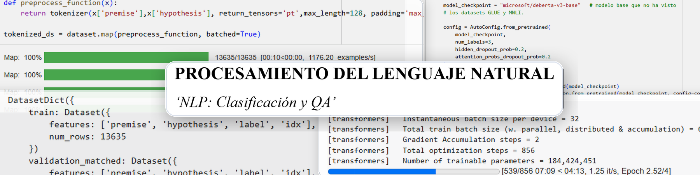

## Proyecto

_ES_:
Notebooks para aprender a realizar tareas NLP: clasificación (dataset MNLI) y 'Question-Answering' (dataset SQuAD).

_EN_:
Notebooks to learn how to perform NLP tasks: classification (MNLI dataset) and 'Question-Answering' (SQuAD dataset).

## Descipción de archivos

| Archivo | Descripción |
|---|---|
| Classification Fine-tuning.ipynb | Notebook de clasificación de texto (MNLI)|
| Question Answering Fine-tuning.ipynb | Notebook de QA (SQuAD)|
